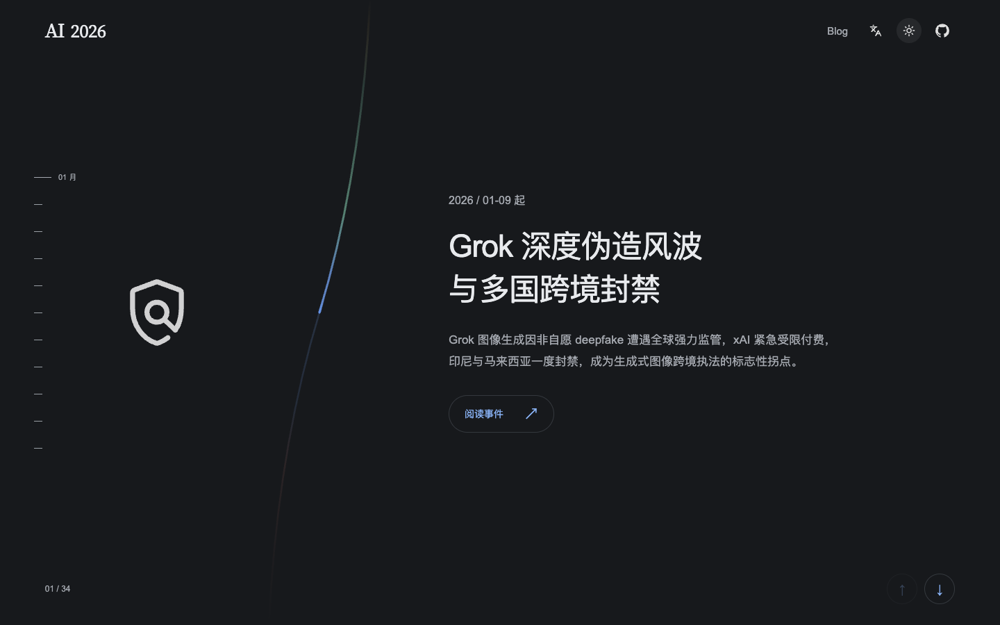
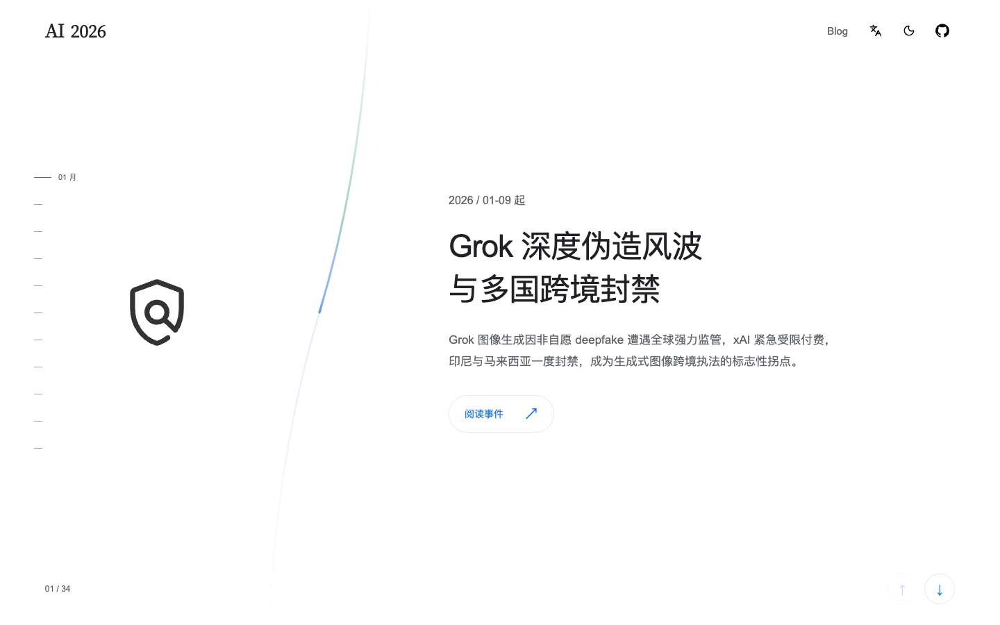
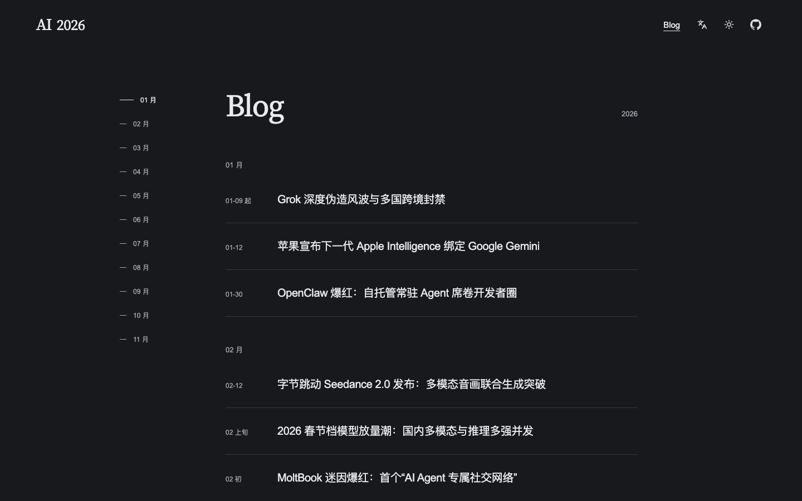
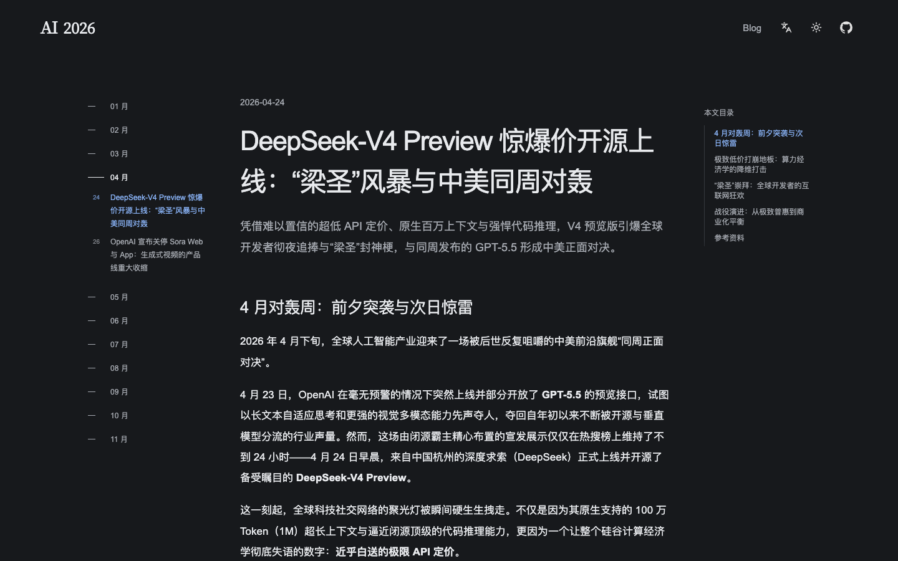

# AI 2026 · 人工智能纪事

> **2026 年人工智能重大事件全景回顾** · 竖向平滑轨迹交互与 34 篇深度事件档案

[](https://wangzh12023.github.io/ai-2026/)
[](https://wangzh12023.github.io/ai-2026/blog/)
[](https://astro.build)
[](https://gsap.com)
[](LICENSE)

[🌐 在线预览 (Live Demo)](https://wangzh12023.github.io/ai-2026/) · [📖 博客归档 (Blog Index)](https://wangzh12023.github.io/ai-2026/blog/)

---

## 视觉预览

| 竖向交互时间线（暗色模式） | 时间线（浅色模式） |
| :---: | :---: |
|  |  |

| 博客编年归档 | 深度事件档案与双侧轨目录 |
| :---: | :---: |
|  |  |

---

## 项目特性

- **34 篇高密度中文深度档案**：涵盖 Grok 深度伪造跨境封禁、苹果结盟 Gemini、OpenClaw 自托管 Agent 浪潮、Claude Code 50 万行工程泄露、DeepSeek-V4“梁圣”惊爆价风暴、月之暗面 2.8T 巨型开源、Claude 形式化费马大定理、币安 63 亿美元 AI 劫案、百度文心 5.5 Flash 开源大反击，以及黄仁勋突辞英伟达 CEO 等年度风云。
- **纯粹丝滑的阅读交互**：
  - **连续轨迹吸附**：基于 GSAP ScrollTrigger 与 Lenis 实现无阶跃滚轮衰减与单事件柔和吸附；
  - **沉浸式时间轴**：Google 四色渐变线条引路，双向联动左侧月份轴与中央焦点舞台；
  - **工程级阅读排版**：双侧栏导航（左侧月份时间线 + 右侧章节滚动侦测目录）、中英文无缝切换与深色模式自适应。
- **零外部运行时依赖**：无运行时 CDN 依赖，SVG 图标与字体完全本地托管，静态编译极速分发。

---

## 快速开始

### 本地运行

```bash
# 1. 安装依赖
npm install

# 2. 启动本地开发服务
npm run dev

# 3. 生产环境打包
npm run build
```

本地开发地址：`http://localhost:5173`。构建产物输出至 `dist/`，可一键部署至 GitHub Pages、Cloudflare Pages 或 Vercel。

---

## 项目结构

```text
ai-2026/
├── src/
│   ├── content/posts/      # 34 篇重大事件 Markdown 深度长文
│   ├── pages/
│   │   ├── index.astro     # 竖向时间线 Landing Page
│   │   ├── blog.astro      # 按月份编年排列的 Blog 聚合页
│   │   └── posts/[slug].astro # 独立长文阅读页（双侧栏 + TOC）
│   ├── components/         # 页面头部、月份归档与目录组件
│   ├── events.json         # 34 个主事件元数据单一事实源
│   ├── locales/            # 中英文多语言对照词表
│   └── main.js             # 时间线 GSAP 摄像机与滚动运动核心
├── public/
│   ├── icons/              # 各大模型与厂商官方 SVG 品牌资产
│   └── screenshots/        # 项目展示截图
└── astro.config.mjs        # 静态站点与子路径构建配置
```

---

## 鸣谢与来源

- **动效灵感**：参考 [EmiraIT](https://codepen.io/sainul/pen/bNqMpXq) 的 SVG Timeline 路径绘制概念；
- **排版参考**：目录侦测参考 [AstroSage](https://github.com/chintak/astro-sage)；文章版式参考 [Thibaud Frere](https://github.com/tfrere/research-article-template)；
- **品牌图标**：收录自 [Lobe Icons](https://github.com/lobehub/lobe-icons) 与 [Simple Icons](https://simpleicons.org/)，遵循各自开源许可证与品牌规范。

---

## 许可证

本项目开源代码基于 [MIT License](LICENSE) 发布。
